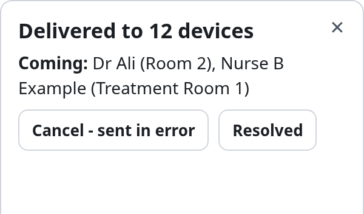
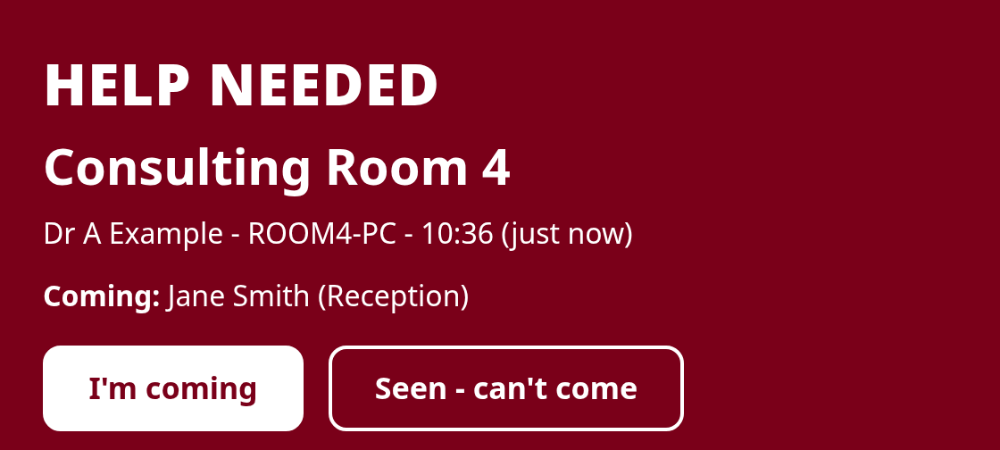

# Muster: calling colleagues for help

Muster puts a red button in the bottom right corner of your screen. It calls colleagues in the building to your room. It does not call 999 or anyone outside the practice, so follow your practice's emergency procedures as well.

## To call for help

Press and hold the red button until the ring goes all the way round. This takes about one and a half seconds.

Your computer makes no sound once the alarm has gone, so nobody in the room is alerted. A small panel next to the button tells you what is happening:

- "Delivered to 12 devices" means colleagues' computers have the alarm.
- "Coming:" lists the people on their way.
- "Could not reach other devices. Call for help another way." means nobody got the alarm. Use the phone, or go and get someone.

If you let go before the ring is full, nothing is sent. Moving the mouse while you hold does not stop the alarm.

## If you pressed it by mistake

Click Cancel - sent in error, then Cancel alarm. Everyone's screen then shows that it was sent in error.

## When it is over

Click Resolved, then Resolve. Everyone's screen shows who resolved it, so colleagues know they can stand down.

## When a colleague needs help

A red window appears and an alarm sounds:

It shows the room, who called and when. Click I'm coming if you can go, or Seen - can't come if you cannot leave. The sound stops when you click. The window stays open until the alarm is resolved, so you can see who else is coming.

## The shape on the button

| Shape | Meaning | What to do |
|---|---|---|
| Green circle | Muster can reach other computers. | Nothing. |
| Amber triangle | It can reach some, or there is a problem such as no sound. | Tell your Practice Admin. They can see why on the Status tab: click the Muster icon by the clock and choose Open Muster. |
| Red square | It cannot reach any other computer. An alarm from here will not get through. | Tell your Practice Admin, and use another way to call for help until it is fixed. |

## Test alarms

Your practice may run test alarms. They show "Test alarm received - no action needed" next to the button, without the alarm sound. You do not need to do anything.

## Moving the button

Hold the Shift key and drag the button to where you want it.
